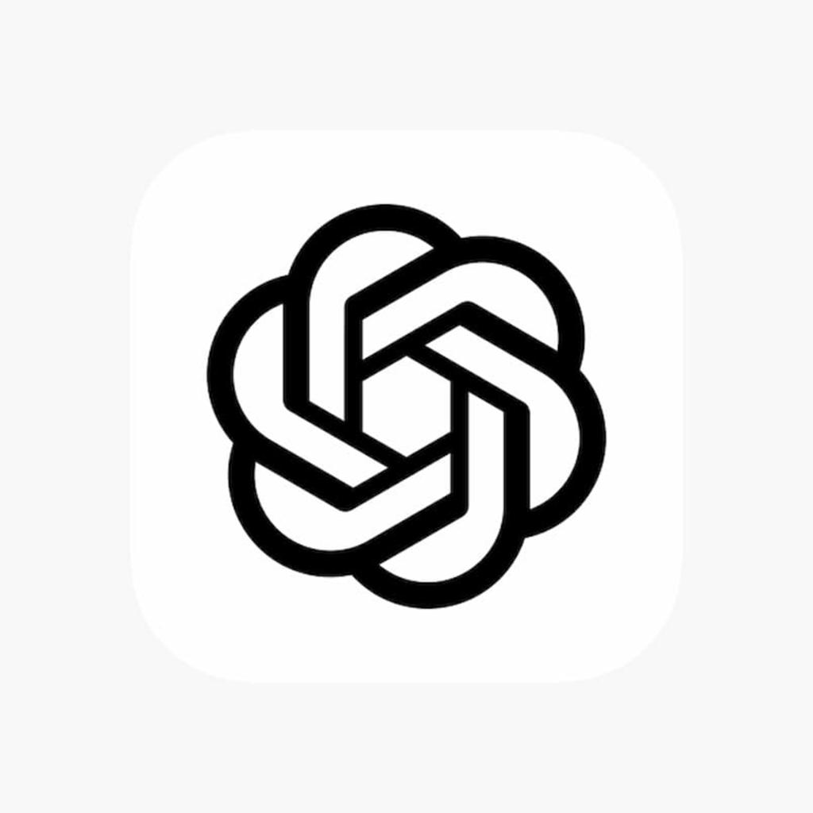
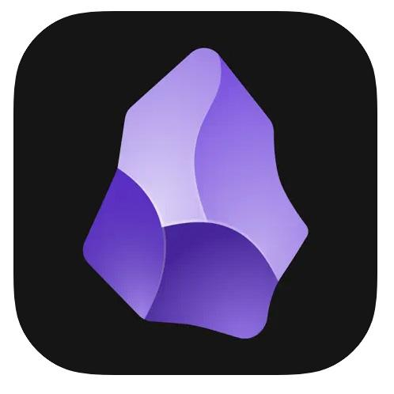
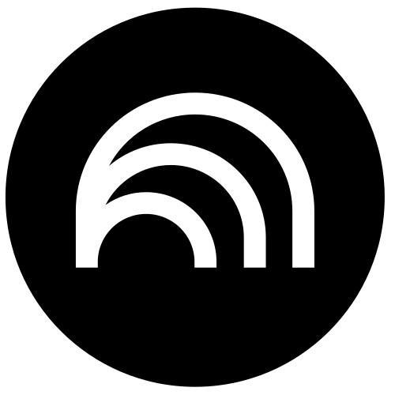
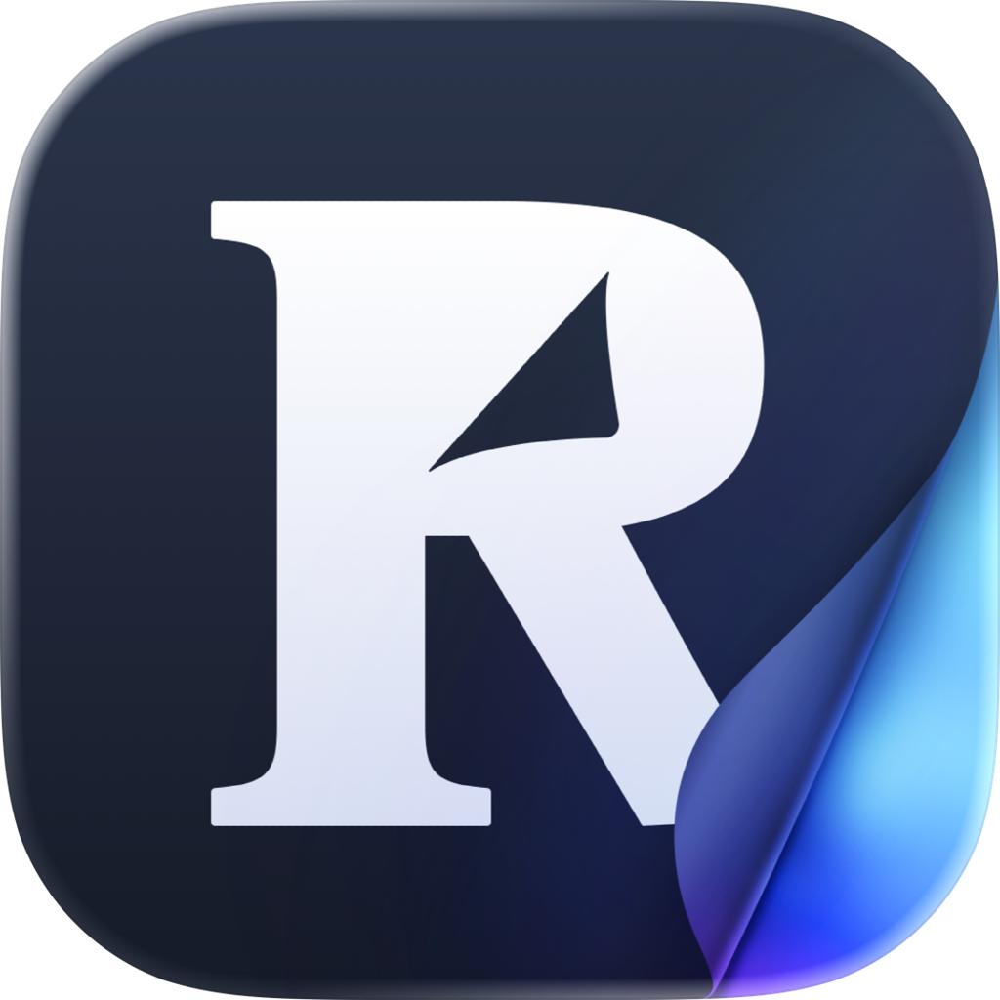
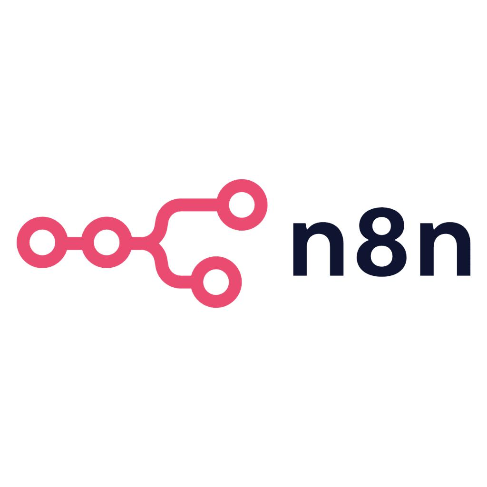

# 用 AI 打造个人数字生活：从工具使用者升级为个人智能系统的管理者

> 我建议把目标设定为：建立一套能够**持续获取高质量信息、帮助独立思考、积累个人知识、辅助决策，并推动长期成长**的个人 AI 系统。

它不仅是一个 AI 助手，也不仅是一个知识库，而是一套围绕个人生活、工作与学习运转的数字化体系。

尤其对于已经具备软件开发基础、正在学习 Agent 和 AI Coding，同时希望提升认知能力与工作效率的人，真正的机会不在于安装更多工具，而在于**把 AI 与日常行为、知识和目标连接起来**。

---

## 一、个人 AI 数字生活的整体架构

```
┌─────────────────────────────────────────────────────────────┐
│  个人长期目标                                                │
│  认知提升 · 职业发展 · 身心健康 · 家庭生活 · 个人创造          │
└─────────────────────┬───────────────────────────────────────┘
                      ▼
┌──────────┐   ┌──────────┐   ┌──────────┐   ┌──────────┐
│  信息获取  │──▶│  认知训练  │──▶│  知识沉淀  │──▶│  行动执行  │
│发现与筛选  │   │理解、质疑、│   │ 笔记、经验 │   │计划、自动化│
│高质量资讯  │   │ 建立模型  │   │ 与方法论   │   │ 与 Agent  │
└──────────┘   └──────────┘   └──────────┘   └─────┬────┘
                                                     ▼
                     ┌──────────────────────────────────────┐
                     │        反馈与持续进化                  │
                     │  定期复盘 → 发现认知偏差 → 调整策略    │
                     │  → 更新知识 → 改进行动                │
                     └──────────────────────────────────────┘
```

其中有一个重要区别：

| 层级 | 含义 |
|------|------|
| **数字化** | 将信息、日程、笔记和任务保存下来 |
| **智能化** | 让 AI 理解这些信息之间的关联，提出建议，并帮助执行 |
| **个人成长系统化** | 建立可持续的反馈机制，让经验逐渐转化为判断能力和行为习惯 |

> 第三层才是我认为最值得投入的方向。

---

## 二、需要哪些工具？按功能选择，而不是按热度选择

下面这套工具组合主要面向 **Mac、iPhone 和跨设备**使用环境，尽量减少重复功能。

| 系统环节 | 推荐工具 | 核心价值 | 优先级 |
|----------|----------|----------|--------|
| AI 思考中枢 | ChatGPT、Claude、Gemini | 深度讨论、分析、决策辅助 | **必备** |
| 资讯获取 | Feedly、Inoreader、RSS | 构建高质量信息源，降低算法推荐干扰 | 高 |
| 深度阅读 | Readwise Reader、浏览器阅读模式 | 收集、阅读、标注、回顾 | 高 |
| 文献研究 | NotebookLM、Perplexity | 多文档理解、证据核对、主题研究 | 高 |
| 个人知识库 | Obsidian、Notion、Markdown | 长期积累知识与个人经验 | **必备** |
| 任务与日程 | Apple 提醒事项、日历、Todoist | 将思考转化为行动 | 高 |
| 自动化与 Agent | Apple 快捷指令、n8n、OpenCode | 自动执行重复流程 | 中高 |
| 行为数据 | Apple Health、习惯记录工具 | 观察睡眠、运动、生活习惯 | 中 |

> 这些工具不需要全部安装。更合理的做法是**每个环节选一个主要工具**，其余工具只在确实有新价值时引入。

### 重点推荐的五种工具

#### 1. ChatGPT — 个人 AI 思考中枢



适合长期主题研究、认知训练、方案评估、写作和复盘。可以通过 **Projects（项目）** 集中管理相关对话、文件与指令，形成持续性工作空间。


*OpenAI Help Center*

> 建议作为日常 AI 交互的**主要入口**，而不是每种任务都换一个模型。

---

#### 2. Obsidian — 长期个人知识库



支持本地 Markdown、双向链接、扩展插件和网页剪藏。适合作为**个人知识资产的主要存储位置**。


*Obsidian Help*

> 尤其适合希望长期保留数据、不被单一云平台锁定的人。

---

#### 3. NotebookLM — 文档研究助手



适合基于论文、报告、书籍等资料开展专题研究，帮助发现文档间的联系，并围绕来源材料提问。


*blog.google*

> 适合回答"这些资料究竟证明了什么"，而不是只生成一份摘要。

---

#### 4. Readwise Reader — 信息阅读与摘录中心



能集中管理文章、PDF、电子书和视频等材料，支持标注、回顾及向 Obsidian 等工具导出。其 **2026 年更新**还增加了 MCP 和 AI 工作流能力。


*Readwise Docs +2*

> 适合解决"收藏了很多文章，却没有真正吸收"的问题。

---

#### 5. n8n — 自动化工作流平台



适合把定时触发、资讯筛选、模型处理、知识库写入与通知串成**可观察的流程**。

> 有开发基础的人可以逐渐增加自动化程度，但不建议一开始就构建复杂的自主 Agent。

**我的建议：** 先建立 `ChatGPT + RSS + Obsidian` 这三个基础能力，再按需要增加 Reader、NotebookLM 和 n8n。

---

## 三、哪些资讯最能提升认知？建立个人信息营养结构

AI 可以帮你阅读更多信息，但**信息数量并不等于认知质量**。

建议把阅读内容分成五大类，避免长期被 AI、科技新闻或者工作相关资讯占据全部注意力。

### 建议的每周深度阅读时间分配

> 可根据阶段目标调整

| 类别 | 占比 | 涵盖内容 |
|------|:----:|----------|
| **专业技术与 AI** | 30% | 模型、Agent、AI Coding、工程实践 |
| **认知科学与心理学** | 25% | 学习科学、思维偏差、行为改变 |
| **经济与社会** | 20% | 经济学、组织管理、历史、社会制度 |
| **健康与生活** | 15% | 运动科学、睡眠、营养、家庭教育 |
| **哲学与人文** | 10% | 逻辑、伦理、经典著作、审美 |

> 比例是起步建议，不是科学确定的最优分配。它的目的是帮助你**保证信息多样性**。

### 值得长期关注的高质量来源

| 领域 | 推荐来源 | 适合培养的能力 |
|------|----------|----------------|
| **AI 与软件工程** | [arXiv](https://arxiv.org/)、[Simon Willison](https://simonwillison.net/)、[Martin Fowler](https://martinfowler.com/) | 技术判断、工程思维 |
| **认知与决策** | [Farnam Street](https://fs.blog/)、[Behavioral Scientist](https://behavioralscientist.org/) | 心智模型、决策质量 |
| **学习科学** | [The Learning Scientists](https://www.learningscientists.org/)、[Learning How to Learn](https://www.coursera.org/learn/learning-how-to-learn/) | 高效学习、记忆与迁移 |
| **经济与社会** | [Our World in Data](https://ourworldindata.org/)、[NBER](https://www.nber.org/) | 数据素养、因果推理 |
| **科学与健康** | [Cochrane](https://www.cochrane.org/)、[PubMed](https://pubmed.ncbi.nlm.nih.gov/) | 证据评价、科学判断 |
| **哲学与人文** | [Stanford Encyclopedia of Philosophy](https://plato.stanford.edu/) | 概念辨析、论证能力 |

这里需要区分来源的角色：

- **arXiv** 是预印本平台，**NBER** 工作论文也未必经过正式同行评议
- **个人博客**擅长提供经验与观点
- **系统综述、原始研究和专业百科**则适合承担不同类型的证据责任

一个值得坚持的原则是：

> **每天**关注少量新资讯，**每周**阅读几篇深度文章，**每月**围绕一个重要问题开展专题研究。

这样能减少"知道很多新概念，但理解始终停留在表面"的情况。

---

## 四、真正值得训练的七项认知能力

工具可以提高信息处理效率，但个人成长最终取决于**思维能力的改变**。

| 核心能力 | AI 可以怎么帮助 | 建议训练 |
|----------|-----------------|----------|
| **批判性思维** | 识别论证漏洞、反例和证据不足 | 对重要观点提出最强反对意见 |
| **第一性原理** | 拆解假设、约束与基本机制 | 把复杂问题还原为基本事实 |
| **系统思维** | 分析变量、反馈回路与长期后果 | 绘制问题的因果关系图 |
| **迁移能力** | 比较不同领域的相似机制 | 每学一个概念寻找两个跨领域应用 |
| **决策能力** | 构建方案、权衡风险与机会成本 | 记录决策依据和事后结果 |
| **元认知** | 发现自己理解上的盲点 | 定期让 AI 测试，而非直接解释 |
| **表达与创造** | 组织论证、模拟质疑、完善作品 | 每周输出一份原创分析 |

其中，我建议尤其重视**三个能力**。

### 1. 从信息消费转向主动研究

**普通 AI 使用方式：**

> 帮我总结一下 Agent 的发展趋势。

**更好的方式：**

> 目前 Agent 工程化面临的三个最大制约是什么？分别有哪些研究或工程证据？不同技术路线的分歧在哪里？哪些问题在未来一年最值得持续观察？

这种提问方式能让 AI 从"摘要生成器"转变成**"研究辅助者"**。

### 2. 从获取答案转向训练自己的判断

例如，在面对职场管理问题时，不是简单询问"领导为什么不同意我的方案"，而是要求 AI 从**组织行为学、激励机制、信息不对称、技术决策和权力结构**几个角度解释，再判断哪种解释最符合实际证据。

> 关键是让 AI 提供不同解释和验证方法，而不是直接替你决定哪个解释正确。

### 3. 从学习知识转向跨领域迁移

例如，学习软件工程中的反馈控制机制，可以进一步思考：

- 为什么运动训练需要渐进负荷和及时反馈？
- 为什么组织管理中的单一汇报渠道可能造成信息失真？
- 为什么个人习惯培养也需要反馈周期？
- 这些场景哪些机制相通，哪些只是表面相似？

这种训练比记住更多知识点**更有价值**。

---

## 五、设计五种长期运行的个人 AI 助手

不必立即开发五个独立 Agent。前期可以用**五个 ChatGPT Projects 或五套固定工作流**实现，等流程稳定后再自动化。

### 1. 资讯研究助手

每天筛选高质量信息，标注事实、解释与预测，关联历史事件，推荐值得深读的资料。

> **输出：** 每日简报、每周专题、每月趋势分析

### 2. 认知训练助手

使用苏格拉底式提问、反例挑战、概念辨析和迁移练习，检验自己是否真正理解。

> **输出：** 认知盲点、能力训练题、个人心智模型

### 3. 职业成长助手

跟踪重要项目、工作复盘、工程能力、沟通策略和长期职业发展目标。

> **输出：** 技能差距、项目复盘、下一阶段提升方案

### 4. 生活健康助手

根据主动记录的睡眠、运动、精力和习惯数据，分析个人生活规律，并给出可以验证的调整建议。

> **输出：** 生活习惯趋势、运动计划、改善实验

### 5. 目标执行与复盘助手

将长期目标拆为周期任务，跟踪承诺与完成情况，帮助识别计划与行动之间的差距。

> **输出：** 每周行动计划、复盘报告、下一步建议

---

> 💡 对于外部日程，可以连接 Google Calendar，使 AI 在获得授权后读取或管理日程，而不用总是手动提供安排。涉及敏感信息时，建议尽量只授予必需的数据权限，自动化的写入与删除操作**保留人工确认**。

---

## 六、个人 AI 数字生活的实际运行方式

比较理想的状态是：每天只需要少量主动输入，系统就能**持续支持学习、决策和行动**。

### 典型的一周（建议的起步节奏）

| 时间 | 耗时 | 主题 | 具体内容 |
|------|------|------|----------|
| **每天** | 20–30 分钟 | 信息筛选 + 认知训练 | 10 分钟查看高质量资讯，10–20 分钟阅读、思考或与 AI 深度讨论一个问题 |
| **周三** | 30 分钟 | 专题研究 | 选择一个重要问题，收集不同来源，比较证据，形成一份简短研究笔记 |
| **周五** | 30 分钟 | 专业能力提升 | 精读 AI、Agent 或工程实践资料，并提炼一个可以在实际工作中验证的技术方法 |
| **周日** | 30–45 分钟 | 个人成长复盘 | 检查目标完成情况，梳理重要学习成果、错误判断和下周行动 |
| **每月** | 60 分钟 | 长期方向调整 | 检查职业、学习、健康、家庭等领域的投入是否符合自己的长期目标 |

---

## 七、30 天落地计划

为了避免一开始就陷入工具搭建，我建议按以下顺序推进。

> **实施进度：`0/16` 项**

### 第 1 周：建立个人信息输入体系

- [ ] 明确 3–5 个长期关注的主题
- [ ] 整理 10–15 个高质量资讯来源
- [ ] 建立阅读收集入口和一个 AI 研究项目
- [ ] 删除明显重复、低质量的信息订阅

### 第 2 周：建立知识与认知训练体系

- [ ] 确定唯一主知识库，使用 Markdown 为主要存储格式
- [ ] 建立主题笔记、思考笔记、决策记录三个模板
- [ ] 针对一个专题完成深入研究
- [ ] 将研究结论转化为自己的观点，而非直接保存 AI 摘要

### 第 3 周：建立行动与自动化体系

- [ ] 设置每日简报与每周复盘流程
- [ ] 让重要结论对应可执行任务
- [ ] 实现一个简单自动化，如 `RSS → AI 筛选 → 阅读列表`
- [ ] 为 AI 输出增加引用来源与人工审核

### 第 4 周：形成可持续的个人成长闭环

- [ ] 复盘四周的学习与行动记录
- [ ] 评估哪些信息真正改变了自己的认知或行为
- [ ] 淘汰低价值工具与流程
- [ ] 确定下一月的重点问题和一个可衡量目标

> 📋 **计划与进度可随时复制和调整。**

---

## 八、如何评价这套系统有没有真正提升自己？

不建议用收藏文章数量、AI 对话次数或者笔记总数作为核心指标。

真正应该观察的是以下指标：

| 指标 | 可以怎样衡量 |
|------|--------------|
| **知识理解** | 能否不看资料，清楚解释一个概念 |
| **独立判断** | 能否指出证据局限、提出备选解释 |
| **知识迁移** | 每月是否能将某个知识应用到新场景 |
| **工作改善** | 是否减少了返工、重复劳动或决策失误 |
| **成长成果** | 是否完成实践项目、文章或技能训练 |
| **生活质量** | 精力、时间管理和长期习惯是否改善 |

> ⚠️ **尤其要防范三种副作用：**
> 1. AI 给出的流畅解释制造了"我已经理解"的错觉
> 2. 过多资讯挤占深度思考时间
> 3. 把越来越多的个人判断交给 AI，导致自主决策能力下降

**最好的 AI 系统应该降低信息处理负担，却提高你对关键问题的思考投入。**

---

## 九、结合你的情况，我更建议走这条路线

考虑到你已有软件开发背景，正在持续研究 **Agent、Skills、MCP、AI Coding**，同时也关注认知提升、职场能力、健康和家庭生活，可以把这一系统设计成**三个递进层次**。

### 第一层：个人知识与研究系统

`ChatGPT + RSS + Markdown 知识库`

优先解决**信息质量、知识积累、认知训练**三个问题。

### 第二层：个人自动化工作系统

引入日程、任务、阅读整理和定期复盘，让 AI 从**分析工具**扩展为**执行助手**。

### 第三层：个人 Agent 与数字资产体系

通过 **Skills、MCP、OpenCode 和脚本**，将可复用的方法与知识封装为个人能力模块，并保留数据控制权。

---

实际上，你正在开发的 Markdown 笔记软件也可以成为第三层的一部分：将笔记存储、阅读摘录、AI 检索、知识关联与个人工作流连接起来。不过建议**先验证完整流程的实际价值**，再考虑自己开发基础设施。

---

> 最终目标不是打造一个无所不能的 AI，而是让自己拥有一个**越来越了解问题背景、能够调用过去经验、持续帮助思考和行动的个人智能工作环境**。

**我建议从一个具体项目开始：**

> 建立你的**个人 AI 认知成长中心**，先围绕"专业技术、认知与决策、生活成长"三个主题运行 **30 天**。等确实产生收益，再逐步扩展自动化和 Agent 能力。